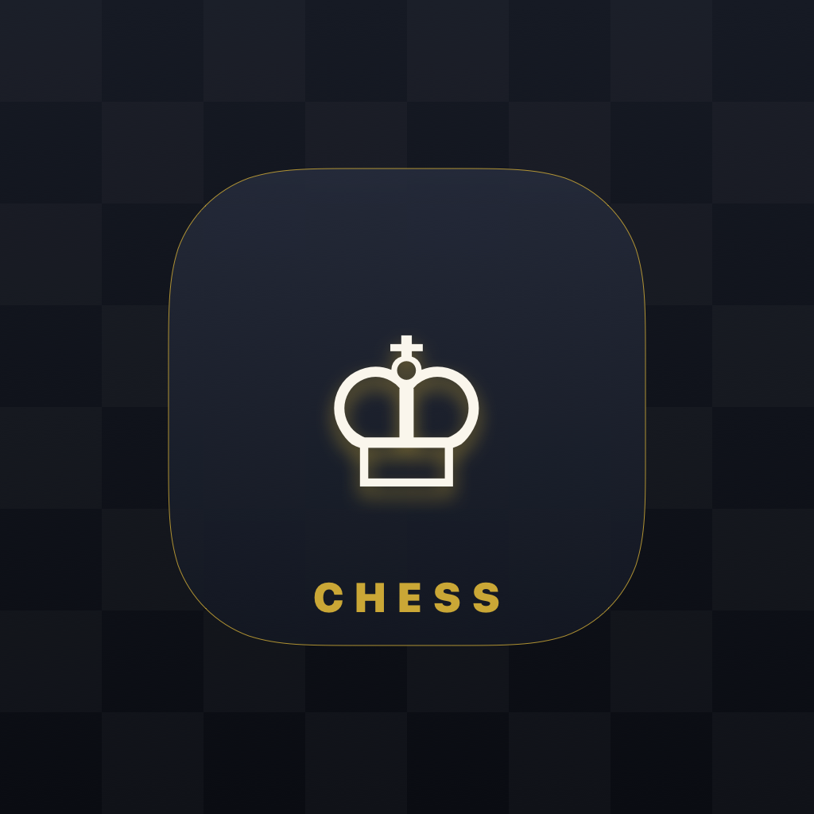

<p align="center">
  
</p>

<h1 align="center">Chess Offline (អុកចត្រង្គក្រៅបណ្ដាញ)</h1>

<p align="center">
  A modern, offline two-player chess application crafted natively with <b>SwiftUI</b> for iOS and iPadOS. Designed for tabletop and face-to-face play, featuring customizable board themes, flexible timer controls, bilingual support (English & Khmer), and light/dark theme options.
</p>

<p align="center">
  
  
  
  
</p>

---

## ✨ Features

- **⚔️ Two-Player Offline Modes**:
  - **Face to Face**: The top player's HUD is inverted 180° for two opponents sitting across each other on a flat surface or iPad table.
  - **Pass & Play**: Both players view the board upright with optional auto-rotation per turn.
- **🌐 Bilingual Localization**:
  - Toggle seamlessly between **English** and **Khmer (ភាសាខ្មែរ)** in settings.
  - Complete terminology for pieces, moves, alerts, timers, and game states.
- **🎨 Appearance & Themes**:
  - **System Themes**: Supports **System Default**, **Light**, and **Dark** modes.
  - **Board Themes**: 4 elegant board styles:
    - *Classic Wood* (ឈើបុរាណ)
    - *Tournament Emerald* (ត្បូងមរកត)
    - *Modern Slate* (ថ្មក្រានីតទំនើប)
    - *Deep Ocean* (សមុទ្រជ្រៅ)
- **⏱️ Flexible Time Controls**:
  - Unlimited (No Timer)
  - Blitz (3 min / 5 min)
  - Rapid (10 min / 15 min)
  - Classical (30 min)
- **📜 Move History & SAN Notation**:
  - Full algebraic notation tracking (SAN).
  - Inspect every turn and move pair in a clean sheet.
- **⚡ Full Standard Chess Rules**:
  - Legal move generation & check/checkmate detection.
  - Castling (kingside & queenside).
  - En passant capture.
  - Pawn promotion sheet (Queen, Rook, Bishop, Knight).
  - Stalemate & mutual draw agreements.
  - Undo move capability with complete state rollback.
- **📳 Haptics & Sound Feedback**:
  - Audio and haptic cues on moves, captures, and checks.

---

## 📱 Screenshots & Previews

| Board (Face-to-Face) | Settings & Appearance | Move History |
| :---: | :---: | :---: |
| Dual HUD with captured pieces & clocks | Language & theme customization | Complete SAN move notation |

---

## 🛠️ Tech Stack & Architecture

- **UI Framework**: SwiftUI (iOS 17+)
- **Architecture**: MVVM with Swift Observation (`@Observable`)
- **Engine**: Pure Swift rule validation and move calculation (`ChessEngine.swift`)
- **Design System**: SF Pro & Apple Typography with vector piece rendering and high-contrast styling

### Project Directory Structure

```text
IOS27/
├── MyApp.swift                        # App Entry Point & Root Scheme
├── ContentView.swift                  # Main Game Layout & Overlays
├── Engine/
│   └── ChessEngine.swift              # Core Chess Rules, Validation & State
├── Models/
│   ├── ChessModels.swift              # Piece, Board, Move, and Theme Models
│   └── AppLocalization.swift          # Bilingual Strings (EN / KM) & Theme Enums
├── ViewModels/
│   └── ChessGameViewModel.swift       # Observable State, Clocks, & Action Handlers
├── Views/
│   ├── ChessBoardViews.swift          # Interactive 8x8 Board & Square Components
│   ├── ChessPieceView.swift           # High-Contrast Piece Glyphs & Shadows
│   ├── GameControlsView.swift         # Actions Bar (Undo, Flip, Moves, Resign)
│   ├── GameModalViews.swift           # Settings, History, Promotion, Game Over
│   ├── LaunchScreenView.swift         # Animated Splash & Branding
│   └── PlayerHUDView.swift            # Clocks, Avatars, & Captured Pieces
├── docs/
│   └── images/
│       └── logo.png                   # Repository Logo Asset
└── Assets.xcassets/
    ├── AppIcon.appiconset/            # Universal App Icon (1024x1024)
    └── LaunchLogo.imageset/           # High-Resolution Launch Logo
```

---

## 🚀 Getting Started

### Prerequisites

- macOS Sonoma 14.0 or newer
- Xcode 15.0 or newer
- iOS 17.0+ deployment target

### Installation & Run

1. **Clone the repository**:
   ```bash
   git clone https://github.com/<your-username>/ChessOffline.git
   cd ChessOffline
   ```

2. **Open in Xcode**:
   ```bash
   open IOS27.xcodeproj
   ```

3. **Select a Target & Destination**:
   - Choose the `IOS27` scheme.
   - Select an iOS Simulator (e.g., iPhone 16 Pro, iPad Pro) or connected device.

4. **Build & Run**:
   - Press `Cmd + R` to compile and launch.

---

## 📄 License

This project is open-source and available under the [MIT License](LICENSE).
